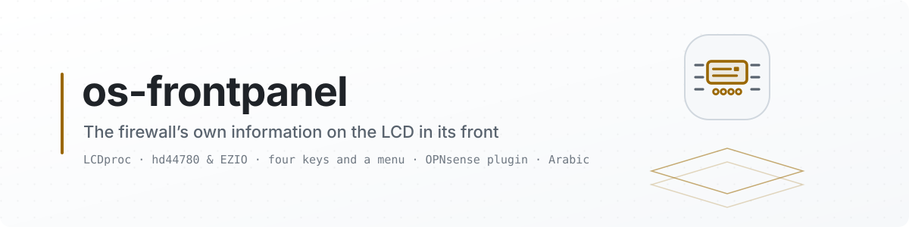

<picture>
  <source media="(prefers-color-scheme: dark)" srcset="docs/images/readme/banner-dark.svg">
  <source media="(prefers-color-scheme: light)" srcset="docs/images/readme/banner-light.svg">
  
</picture>

<p align="center">
  <a href="https://github.com/AbdelmonemAwad/os-frontpanel/releases/latest"></a>
  <a href="https://github.com/AbdelmonemAwad/os-frontpanel/actions/workflows/checks.yml"></a>
  <a href="LICENSE"></a>
  <a href="#front-panel-for-opnsense"></a>
  <a href="https://github.com/AbdelmonemAwad/opnsense-arabic"></a>
  <a href="https://github.com/AbdelmonemAwad/os-xgs-npu"></a>
  <br>
  <a href="#the-keys"></a>
  <a href="#the-buttons-and-the-menu"></a>
</p>

# Front Panel for OPNsense

A plugin that puts the firewall's own information on the **LCD built into the front of the
appliance** — hostname and address, WAN state, throughput, CPU, memory, uptime, temperature — and
gives the buttons beside it something to do.

**This plugin writes no display code.** That is the first thing to say about it, because it decides
everything else. LCDproc already speaks to panels like this one, and OPNsense already carries
LCDproc in its own repository. What was missing was never a driver. It was the part that decides
what a firewall should say on two lines of sixteen characters, and a page in the GUI to configure
that from — instead of hand-editing a file on the firewall and restarting a daemon by hand every
time you want the screens to go a little slower.

| Layer | Where it comes from |
| --- | --- |
| The engine: `LCDd`, its clients, and 36 drivers | the `lcdproc` package in the OPNsense repository — `lcdproc-0.5.9_1` (measured here) |
| The driver for the panel in this machine | `hd44780` with `ConnectionType=ezio` on `/dev/cuau1` (measured here) |
| Which screens exist, what they say, how fast they move, and the settings page | this plugin |

So there is no serial code in this repository. The plugin generates LCDd's configuration from your
settings, runs its own service, and hands screens to LCDd as one more LCDproc client on the loopback
interface. When the panel does not light, the fault is in a configuration file you can read rather
than in code you cannot.

Tested on OPNsense 26.7.4_1 / FreeBSD 15.1, on one machine: an ex-Sophos XG 330 rev 2 whose front
panel is 16×2 characters with four keys, on the second of its two serial ports. Everything below
that says **measured here** was measured on that machine; everything else is marked where it
matters. The hardware table ships with **exactly one confirmed entry**, and
[Other appliances](#other-appliances) says what that means for yours.

<p align="center"><b>Contents:</b> <a href="#the-screen-that-said-sophos-for-months">The screen that said SOPHOS for months</a> &middot; <a href="#what-you-need">What you need</a> &middot; <a href="#nothing-runs-until-you-turn-it-on">Nothing runs until you turn it on</a> &middot; <a href="#the-page">The page</a> &middot; <a href="#settings-and-the-speeds">Settings, and the speeds</a> &middot; <a href="#screens">Screens</a> &middot; <a href="#the-keys">The keys</a> &middot; <a href="#the-buttons-and-the-menu">The buttons and the menu</a> &middot; <a href="#other-appliances">Other appliances</a> &middot; <a href="#installation">Installation</a> &middot; <a href="#how-it-works">How it works</a> &middot; <a href="#the-gui-in-arabic">The GUI in Arabic</a> &middot; <a href="#what-it-does-not-do">What it does not do</a> &middot; <a href="#in-the-xgs-image">In the XGS image</a> &middot; <a href="#updates">Updates</a> &middot; <a href="#license">License</a></p>

## The screen that said SOPHOS for months

This appliance ran Sophos firmware before it ran OPNsense. On the day OPNsense was installed, the
front LCD kept the last thing the vendor's firmware had written to it — a splash line with the
vendor's name on it — and there it stayed, month after month, while the machine underneath was
reinstalled, reconfigured and rebooted.

That is not a fault, and it is worth understanding before you go looking for one. A character LCD of
this family has its own controller and its own memory: whatever was written to it last stays on the
glass for as long as the panel has power, and nothing in a stock OPNsense ever writes to that serial
port. The screen was not frozen. Nobody was talking to it.

What it turned out to be, in the end, was three facts and two lines of configuration:

- **The panel is on the second serial port.** `uart1` at `0x2f8`, IRQ 3 (measured here) — which is
  `/dev/cuau1` on FreeBSD, the port Linux calls `ttyS1`. The first port, `uart0` at `0x3f8`, is the
  system console and must be left alone.
- **The protocol is ordinary.** It is an HD44780 panel behind an EZIO-style serial interface, which
  LCDproc has driven for years: driver `hd44780`, `ConnectionType=ezio`, at the 2400 baud that
  connection type uses by default. Sophos's own firmware drove this same panel with LCDproc's own
  daemon on `/dev/ttyS1` (reported, not verified here). The panel never spoke anything proprietary,
  and nobody was ever going to have to reverse-engineer it.
- **The default that makes a correct configuration look broken is the heartbeat.** LCDproc blinks a
  small icon in a corner to show the server is alive. It draws that icon with a user-defined
  character which this panel renders as a **solid black block** (measured here). With
  `Heartbeat=off`, the same configuration that looked half-broken is simply correct.

Two more lines earned their place while watching it run: `DelayMult=2`, because a slow panel drops
characters when the host talks to it at full speed, and `RefreshDisplay=4`, which redraws the whole
screen every four seconds so that corruption — if any gets through — cannot sit there for an hour.
That second line is not free, and what it costs is paid in key presses; [The keys](#the-keys) is
where that bill is itemised.

With those in place the panel showed live CPU, memory and uptime, and the owner photographed it.
That photograph is the entire evidence behind the one confirmed row in the hardware table, and it is
the standard this plugin asks of anybody adding a second row.

## What you need

One package, from the repository OPNsense already uses:

```sh
pkg install lcdproc
```

That is the whole prerequisite. It brings the server, the demo client and the drivers (measured
here, `lcdproc-0.5.9_1`):

```sh
ls -l /usr/local/sbin/LCDd /usr/local/bin/lcdproc
ls /usr/local/lib/lcdproc/*.so | wc -l          # 36 here
```

Nothing in this plugin works without it, and there is no fallback: the plugin configures LCDd, and
LCDd drives the panel. There is no compiler, no ports tree and no out-of-tree driver anywhere in the
story.

You also need a panel LCDproc can actually drive, on a serial port that is **not** carrying a console
and that nothing else has open. On this machine `/dev/cuau1` carries no console — `/etc/ttys` starts
a getty on `ttyu1` only `onifconsole`, and the console is `ttyu0` (measured here). Checking that on
your own machine is two commands, and [docs/panels.md](docs/panels.md) walks through them.

## Nothing runs until you turn it on

`enabled` is off after installation, and the plugin applies nothing by itself. Once it is on it
stays on across reboots: OPNsense starts the panel from its own boot sequence
(`plugins_configure('bootup')`), not from the `rc.conf.d` switch the first version relied on, which
nothing on an OPNsense boot reads - measured, on two appliances, as a panel that was dark after
every reboot until somebody opened this page.

When the page opens it looks your appliance up in its table and, if it finds a match, **proposes** a
driver and its settings — driver name, device, size, whether to poll the keys. It fills the form in
and stops there. You look at it, and you press Apply.

That is deliberate. Writing an unknown protocol at an unknown speed to a serial port that might be
somebody's console is not a mistake a plugin gets to make on its own initiative, on a machine that is
at that moment routing somebody's traffic.

## The page

System: Front Panel has four tabs, laid out the way OPNsense lays out its own forms:

- **Settings** - the form, with the form's own **Apply**, which writes LCDd's configuration and
  restarts the service.
- **Buttons** - one row per key: what is printed on it, the byte it sends where the panel sends one,
  and what a press does. **Add this appliance's keys** fills the grid from the appliance table, and
  **Learn the codes from the panel** asks for each key on the glass and keeps what it hears - see
  [The buttons and the menu](#the-buttons-and-the-menu).
- **Preview** - every screen as the panel would draw it this second, side by side.
- **Diagnostics** - the service, the keys, the serial ports and which of them carries a login
  prompt, the known-panel entry this appliance matched, and a line to send to the panel.

The long explanations on each tab are under its **full help** switch, as on every OPNsense form.

## Settings, and the speeds

Every speed on this page is adjustable from the GUI, and that is not decoration: it is the one thing
found missing by name after watching the first version run. A pace that is right on one
appliance is unreadable on another — the glass is slower, the bus is slower, or the person reading it
is walking past rather than standing still — and none of that should require editing a file on a
firewall.

| Setting | Default | The LCDd setting it writes | What it does |
| --- | --- | --- | --- |
| `enabled` | off | — | nothing runs until this is on |
| `driver` | from the table | `Driver` | which of the 36 LCDproc drivers to load |
| `device` | `/dev/cuau1` | the driver's `Device` | the serial port, offered from the ports the machine actually has |
| `size` | `16x2` | the driver's `Size` | columns × rows |
| `keypad` | on | the driver's `Keypad` | whether the keys are read at all - by LCDd, or by the plugin on a panel that sends its keys unasked |
| `panel_power` | on | — | whether the panel's menu offers Reboot and Shutdown, each behind a two-step confirmation |
| **`screen_seconds`** | 3 | `WaitTime` | how long each screen is shown before the next one |
| **`scroll_speed`** | 10 | `TitleSpeed` | how fast a line longer than the display scrolls — 0 to 10, where 0 does not scroll at all |
| **`bus_delay`** | 2 | `DelayMult` | the delay multiplier: how long the driver waits between bytes |
| **`refresh_seconds`** | 4 | `RefreshDisplay` | how often the whole screen is redrawn from scratch |
| **`heartbeat`** | off | `Heartbeat` | LCDproc's blinking "I am alive" icon |
| `screens` | a grid | — | which screens appear, and in which order |
| `buttons` | a grid | — | one row per key: its name, the label printed on it, the byte it sends (where it sends one) and what a press does |

The first three speeds are the server's own settings and exist whatever the panel is. The last two
belong to the **driver**: `DelayMult` is an `hd44780` and `sed1520` option and `RefreshDisplay` an
`hd44780` one, and writing either into a section that has never heard of it makes LCDd complain on
every start. So a driver without them simply does not get them, and the page says which knobs it had
to leave out rather than showing you a control that does nothing.

The defaults in that table are the values arrived at on this machine by watching it (measured here):
three seconds a screen rather than the six it was first tried at, because six felt like standing
there waiting — LCDd's own default is four; scrolling at 10, because a 16-column line runs out
quickly; and `DelayMult=2` rather than 1 or 4, because 1 drops characters on this panel and 4 is
slower than it needs to be.

Which knob to reach for:

- **The screens change too fast, or you stand there waiting for the one you want** — `screen_seconds`.
- **A long line crawls, or whips past before you can read it** — `scroll_speed`. Set it to 0 and long
  lines stop moving altogether, which is the right answer on a panel people only glance at.
- **Characters go missing, or a line comes out shifted by one** — raise `bus_delay` to 2, then to 4.
  That is the classic symptom of a panel that cannot keep up with the host, and it is a property of
  the hardware rather than a bug.
- **Corruption appears once and then just sits there** — lower `refresh_seconds`, and know what it
  costs. A full redraw is cheap in time on a 16×2 panel, but on a serial panel it is not free: the
  display and the keypad share the line, and a redraw every few seconds swallows key presses
  (measured here: two thirds of them, with screens changing every three seconds and a redraw every
  four). On a panel whose keys you use, buy the insurance at the widest interval that still cleans up
  after a glitch.
- **Key presses go missing** — the same trade-off from the other side. Give each screen longer with
  `screen_seconds` and raise `refresh_seconds`, or set it to 0 and let a glitch wait for the next
  screen change. A quiet line is a responsive keypad.
- **A solid black block in a corner** — that is the heartbeat, and it is off by default here for
  exactly that reason. Turn it on only if your panel draws it as the small pulsing icon it is meant
  to be.

Changing any of these rewrites the generated LCDd configuration and restarts the plugin's service.
Nothing else on the firewall is touched and no other service is restarted.

## Screens

Each screen is two lines of at most `size` columns, and you choose which ones appear and in what
order:

| Screen | What it shows |
| --- | --- |
| identity | hostname and the LAN address |
| wan | the WAN address, and whether the gateway answers |
| throughput | in and out on an interface you pick |
| system | CPU, memory, uptime |
| temperature | the CPU sensor, on machines that have one |
| ports | the worst port and its verdict — `PortA3 FAIL`, `3.8% bad frames` — **only when os-linkhealth is installed** |
| message | a fixed line you write yourself |

The **message** screen is there because a firewall in a rack is usually read by somebody who is not
its administrator. "Do not power off - ask Abdelmonem" is a perfectly good use of sixteen characters.

The **ports** screen is the only contact this plugin has with my other plugin, os-linkhealth: it
reads `/var/db/linkhealth/status.json` if that file happens to exist, and the screen simply does not
appear in the list if it does not. There is no dependency, no shared code and no package requirement
in either direction. Install one, both, or neither.

## The keys

The panel on this appliance has four keys — ENTER, ESC, up and down — and **all four report**
(measured here, 2026-09-21: each one pressed three times, each press in LCDd's log, nothing lost).
Getting there took two corrections to the obvious procedure, and both of them are worth more than the
result:

- **Nothing is printed at the ordinary report level.** The first runs that recorded a press were at
  `ReportLevel=5`; the runs at 3 logged not one, while the same keys were being pressed (measured
  here). "I saw no key events" usually means the log was never going to show them. Level 4 was
  measured afterwards and is what the plugin writes when the keypad is on: it names every keystroke
  and nothing else, where level 5 adds a line of LCDd's own narration per frame — eight a second,
  which buries the presses it was turned up to find.
- **The screen and the keys share one 2400-baud line, and writing starves polling.** With screens
  changing every three seconds and a full redraw every four, two thirds of the presses were lost.
  With the screen held still, every press arrived (measured here). This is the single most useful
  thing on this page: a keypad that feels unreliable is usually a panel being written to too often.

Which key is which is not something the panel tells you. The driver reports a **matrix position**,
and the name is whatever the configuration calls it, so the map was measured a button at a time:

| Printed on the panel | Matrix position | What LCDd is told to call it |
| --- | --- | --- |
| ▼ | 4,1 | `Down` |
| ESC | 4,2 | `Escape` |
| ▲ | 4,3 | `Up` |
| ENTER | 4,4 | `Enter` |

LCDproc's own sample configuration puts `Enter` on 4,1 — which on this appliance is the down arrow.
A plugin that shipped the driver's defaults as though they were facts would give you a panel whose up
arrow scrolls down. So the map is part of the appliance entry, each entry says in words whether its
map was measured or copied from a cousin, and you can change it from the page without editing a file
on the firewall.

None of which the plugin depends on:

- Screens rotate on a timer, so it is completely useful with no working keys at all. That is the
  design and not a fallback.
- Where keys do report, they earn: next screen, previous screen, and a confirm/back pair for a small
  menu. Nothing in the shipped screens needs a key to be reachable.
- The settings page carries a **key test** that says which position last reported, so somebody on
  unknown hardware finds out in ten seconds instead of guessing for an evening.

## The buttons and the menu

Every key does what its row on the **Buttons** tab says: next or previous screen, open the menu, back
to the rotation, hold or resume the rotation, show one chosen screen, the backlight, or nothing. A key
with no row keeps its default - down for the next screen, up for the previous one, Enter for the
menu, Escape back to the rotation.

The menu is laid out the way the vendor's own firmware lays out its menu on this hardware (read off
the XGS 3300's original firmware): a main menu of lists, each entry opening another list, showing two
lines, or doing something.

| Main menu | What is in it |
| --- | --- |
| System | date and time, uptime, processor and memory, load average, disk, OPNsense version, temperature |
| Network | every assigned interface with its address or why it has none, the default gateway |
| Screens | the rotation's screens - choosing one holds it on the panel |
| Power | Reboot and Shutdown, when `panel_power` is on |

In the menu the arrows move, Enter opens and Escape goes back, whatever the rows say. Reboot and
Shutdown sit behind the vendor's two-step confirmation: Enter opens the entry, a step down reaches
"Confirm", and Enter again carries it out, so no single stray press can. Every request is written to
the system log.

**The XGS 3300's keys are not polled.** Its panel bridge, a GIFAR GMRU20X4, never answers LCDd's key
request (`FE 06` - four requests, nothing back) and instead sends one letter the moment a key goes
down. Measured 2026-10-17 with the owner pressing each key in turn:

| Printed on the panel | Byte sent |
| --- | --- |
| Enter | `41` (A) |
| Esc | `42` (B) |
| ▲ | `43` (C) |
| ▼ | `44` (D) |

LCDd would read such a byte as an answer it did not expect and throw it away, so no press could ever
reach a client. On a panel like this that LCDd still draws, the plugin tells LCDd `Keypad=no` - it
then neither polls nor reads the port - and the screen client opens the same port read-only and takes
the bytes itself; on the XGS 3300, which the plugin draws itself (below), it reads them directly. The
appliance table carries the codes for the panels where they were measured; **Learn the codes from the
panel** finds them on any other panel that sends its keys this way, and a code in the grid outranks the
table.

**The XGS 3300's panel is drawn by the plugin, not by LCDd.** Under LCDd its whole picture crept
around the two rows as if they were one ring of forty characters - the end of the first row came back
at the start of the second, 14 columns along and later 17 (the owner's photographs, 2026-10-17).
Three test patterns photographed on the glass the same day showed why: the bridge carries out **no
positioning command at all** - `FE 01` clear, `FE 02` home, `FE 80`/`FE C0` line addresses and the
rest are swallowed and do nothing, sent back to back or with a pause - and writes every character at a
cursor that runs round all forty cells, the first row and then the second. LCDd rewrites only what
changed, so each update moved the picture by however many characters it wrote.

So where the appliance table says `"direct": true`, LCDd is not started: the screen client draws the
panel itself and only ever writes **forty characters at once, never a command**, which brings the
cursor back to the cell it started from. Which cell that is - wherever earlier writers left it, kept
until the panel loses power - is set once: **Align the text** on the Buttons tab puts a ruler of forty
different characters on the panel and you click the one you see in its top-left corner. While the
ruler is up the panel's arrows move the text one cell a press instead of changing screens, and Enter
or Escape ends it - the same as System > Align the text in the panel's own menu. The keys are read from the
same port, and the page, the rotation, the menu and the test line work the same either way.

Why the keys are hard is worth one sentence, because it explains why "I listened and saw nothing" is
not the end of it: on the XG 330's connection type the keys are **polled**, never volunteered — the host
sends a poll byte and the panel answers with a key code (documented in LCDproc's own
`hd44780-serial.c`). Listening passively to the port therefore shows nothing at all, forever,
whether the keys work or not.

One log line explains the failure most people meet first. `handle_input: left over key` means the
panel reported a press, the driver decoded it, and no client had claimed that key — the keypad is
working and nothing was listening. It is not a reason to change drivers.

If they never report on a given panel, the honest fallback is the `mtc_s16209x` driver, which lights
the screen and can never read a button — its configuration section has no keypad options of any kind
(documented: in LCDproc's own sample configuration that section takes a device, a brightness and a
reboot flag, and nothing else). The page says so rather than pretending.

## Other appliances

The table this plugin ships, `panels.json`, has **two confirmed entries**: the Sophos XG 330 rev 2
above — its display watched and photographed, its four keys measured one at a time, and every word of
that written into the entry so the page can show it to whoever is about to press Apply — and the
Sophos XGS 3300, the same panel family at 9600 baud rather than 2400, its display verified and its
~~keys not yet measured, which the entry says~~ four keys measured on 2026-10-17, which the entry says.

Since 1.0.5 (2026-10-30) a third entry offers the XGS 3300's settings to the other models built on
its board, AMDA0202 - the XGS 2100, 2300 and 3100 - matched on the assembly number the board's
serial carries rather than on model strings nobody here has read, and marked unconfirmed. Until then
the entry had matched the XGS 3300 alone, and an XGS 3100 fell to the general one, whose 2400 baud
garbles this panel ([os-xgs-npu#901](https://github.com/AbdelmonemAwad/os-xgs-npu/issues/901)); ~~9600
has not been confirmed on that model's panel yet~~ an XGS 3100's owner confirmed it that evening: two
lines read right at 9600, at 20x2 once Size was set, and lined up with Align the text. That 3100's ruler
came up with its G in the top-left corner, so since 1.0.6 the entry starts the text at offset 24
wherever nobody has lined it up yet.

Since 1.0.6 (2026-10-31) any other Sophos XGS has an entry of its own, ahead of the general one, for
its size: the XGS panels seen so far are 20 characters by 2 lines, and the general entry's 16x2 - the
older XG panels' size, which they keep - had reached that 3100's saved settings. Like the general
entry, it is a guess and says so.

Everything else is a choice the page offers you, not hardware somebody has tested. The settings page
lists the 36 drivers the `lcdproc` package installs, and "support for other appliances" means exactly
that: exposing the choice, with a table of known-good starting points that grows only when somebody
confirms one. An entry in that table is never applied on its own; it fills the form in, and you press
Apply.

If your appliance has a panel and is not in the table, adding it is one block of JSON and no code.
**[docs/panels.md](docs/panels.md)** is the whole procedure: what to read off your machine, how to
narrow 36 drivers down to a shortlist, how to try one without upsetting the panel or the console, and
what evidence to send with the entry. Please read its safety rules before you point anything at a
serial port.

## Installation

The plugin is not in the OPNsense plugin repository yet, so there is no
`pkg install os-frontpanel`. There is a package, and you build it — on the firewall,
from this repository, in one command. Building needs no root and installs nothing.

```sh
fetch -o /tmp/frontpanel.tar.gz https://github.com/AbdelmonemAwad/os-frontpanel/archive/refs/heads/main.tar.gz
tar -xzf /tmp/frontpanel.tar.gz -C /tmp
cd /tmp/os-frontpanel-main
sh tools/make-package.sh -o /tmp -c sysutils
```

The package declares `lcdproc` as a dependency, so `pkg add` fetches it for you if it
is not already there. LCDproc is what actually speaks to the panel; this plugin
generates its configuration and runs it.

It tells you where it put the package, its digest, and which commit it came from:

```
/tmp/os-frontpanel-1.0.pkg
SHA256 c1fb34e2c13d00019b0f3eefd87fae2ccde769b9111d95a3fede76e40b09b25c
commit 3385f2f76
built on OPNsense 26.7 amd64
```

The digest is of the file you just built. Two builds of the same commit do not
produce the same digest unless the commit date is passed in, because otherwise every
file in the archive carries its own mtime:

```sh
SOURCE_DATE_EPOCH=$(git log -1 --format=%ct) sh tools/make-package.sh -o /tmp
```

Read it before you install it. Nothing about a package file makes it trustworthy, and both of
these questions are answered out of the file itself, without touching the machine:

```sh
pkg info -F  /tmp/os-frontpanel-*.pkg      # version, licence, dependencies, description
pkg info -lF /tmp/os-frontpanel-*.pkg      # every file it will write, and it writes no others
```

Then, as root:

```sh
pkg add /tmp/os-frontpanel-*.pkg
```

Then open **System → Front Panel** - **XGS → Front Panel** when os-xgs-npu is installed.
It is under System rather than Interfaces because
this is about the appliance itself and not about the network it serves.

**Nothing is on the screen yet, and nothing will be until you turn it on.** Look at
what the page proposes for your hardware, change what you disagree with, and press
Apply. A wrong driver writing to the wrong serial port is not a mistake a plugin
should make on its own initiative.

A newer version goes on over an installed one with `pkg add -f`. Settings in `config.xml` and
state under `/var/db` survive, because pkg replaces only the files the package owns.

<details>
<summary>Installing by hand instead, with no package</summary>

`install/install.sh` does the same work and is what existed before there was a package:

```sh
fetch -o /tmp/frontpanel.tar.gz https://github.com/AbdelmonemAwad/os-frontpanel/archive/refs/heads/main.tar.gz
tar -xzf /tmp/frontpanel.tar.gz -C /root
sh /root/os-frontpanel-main/install/install.sh
```

The difference is only in the bookkeeping: pkg does not know the files are there, so
`opnsense-version -c os-frontpanel` answers *not installed* on a machine where the plugin is
running, and removal is `install/uninstall.sh` rather than `pkg delete`.

</details>

### Removing it

```sh
pkg delete os-frontpanel
```

The service is stopped and the panel cleared before the files go. Settings stay in
`config.xml`, so a reinstall comes back with the same driver, the same port and the
same speeds rather than asking you to find them all again.

### What a package outside the OPNsense repository does not get

It is not upgraded by **System → Firmware → Updates**, because that only offers what the
OPNsense repository carries, and this is not in it. A firmware update does not remove it —
the files are pkg's, and OPNsense does not delete packages it did not install — but it will
not be updated either. Build a new package from a newer tag and `pkg add -f` it.

## How it works

- The settings live in `config.xml` like every other OPNsense setting, and the plugin generates
  LCDd's configuration from them, into a file of its own: `/usr/local/etc/frontpanel/LCDd.conf`,
  written fresh every time the service starts. The `lcdproc` package installs only
  `/usr/local/etc/LCDd.conf.sample`, and if you have written an `LCDd.conf` of your own beside it,
  this plugin never reads or touches it — it runs its own server with its own file, so your
  configuration keeps working exactly as it did.
- `src/opnsense/scripts/frontpanel/` holds the screen generators, the configuration writer and the
  hardware table. Each screen is a small function returning two lines, so adding one is small and
  local.
- LCDd opens the serial port while it is still root and then drops to `User=nobody` (measured here:
  `/dev/cuau1` is `uucp:dialer`, mode 0660, and `fstat` shows the running LCDd holding it as
  `nobody`). That is why the daemon does not keep root, and why the port's permissions never have to
  be loosened to make a panel work.
- Before anything starts, the port is checked: that it exists, that it is a character device and not
  something somebody typed by mistake, and that `/etc/ttys` does not give it a login prompt — reading
  the flags properly, so that a port marked `onifconsole` is refused only when it really is the
  console. What the plugin cannot tell you is whether some other daemon already has the port open;
  `fstat /dev/cuau1` can, and [docs/panels.md](docs/panels.md) makes a rule of asking it first.
- It is cheap. A 16×2 panel is 32 characters, and a redraw is a few dozen bytes down a 2400-baud
  line. Nothing here asks the firewall for more than the dashboard already does.

## The GUI in Arabic

The GUI on the reference machine is used in **Arabic, right to left**. Nothing on the settings page
is positioned with a hard-coded left offset, and every visible string goes through the framework's
translation function, so the existing translation pipeline carries this page like any other. Its
Arabic is in [opnsense-arabic](https://github.com/AbdelmonemAwad/opnsense-arabic)'s catalogue with
the rest of the GUI since 2026-10-22; the list of the page's strings stays here, in
`src/opnsense/scripts/frontpanel/i18n/ui/source.json`, and `tools/check-strings.py` fails a string
that has no Arabic there.

The panel itself is a different matter, and it is better said here than discovered at the rack: a
16×2 character LCD has no Arabic in its character generator. LCDproc's default map translates
ISO-8859-1 to the panel's own ROM, and the only other maps compiled into the `hd44780` module shipped
here are `hd44780_euro`, `ea_ks0073` and `sed1278f_0b` (measured here), and not one of them has an
Arabic letter in it. So the **screens are English** whatever the GUI language is. Anything outside plain ASCII
is folded before it is ever sent, on purpose: an accented Latin letter loses its accent, because a
panel that can draw `e` should show `e`, and everything left outside ASCII — Arabic, CJK, an emoji —
becomes `?` rather than whichever arbitrary glyph that panel happens to keep at those codes. No
setting in this plugin changes that. What the plugin does instead is show you: the preview renders
the folded line, and says plainly when folding changed what you typed, so an Arabic `message` is seen
on the page rather than discovered at the rack.

## What it does not do

- It does not write to a serial port itself. LCDd does.
- It does not write to a port that `/etc/ttys` gives a login prompt to; it refuses and says which
  line in that file made it refuse. It cannot see another daemon's open file handle and does not
  pretend to — that check is `fstat`, and the panel documentation makes a rule of it.
- It does not turn itself on after installation, and it applies no table entry without you.
- It does not promise keys on hardware whose driver cannot read them.
- It does not depend on os-linkhealth, does not import a line of it, and os-linkhealth does not know
  this plugin exists. The one point of contact is one status file, read-only and optional.
- It does not claim to support an appliance nobody has tested. One row of the table is confirmed; the
  rest of the world is a driver list, and this document saying so.

## In the XGS image

[xgs-image-builder](https://github.com/AbdelmonemAwad/xgs-image-builder) builds an OPNsense image
for Sophos XGS appliances with this repository in it, installed at the image's first boot. It holds
no copy of this repository: every build takes `main` as it is that day, so a change merged here is
in the next image without anything being done there. What the image calls here - `install/install.sh` and `install/enable.sh` - is checked
from that side every day, so moving or renaming one of them is caught there; keep them where they are.

## Updates

An installed copy is updated to this repository's **releases** by hand: from **XGS: Updates**, its *Plugins*
tab ([os-xgs-npu](https://github.com/AbdelmonemAwad/os-xgs-npu)), or with `/usr/local/opnsense/scripts/frontpanel/self-update.py`. ~~Once a day, at 03:29, from `/usr/local/etc/cron.d/frontpanel-update`~~ - nothing
is installed on its own since 2026-10-20: an update runs when the appliance's owner starts it. It asks GitHub for the latest release and, when it is ahead of what
is installed, downloads it and runs the `install/install.sh` it carries - the same script a hand install
runs. A change merged on `main` reaches installed firewalls when it is released, not before; with
no release published, nothing changes.

- **Only forward.** What is installed is recorded in `/usr/local/share/os-frontpanel/installed.json` by
  the installer - the commit, from a git checkout or from the `.source-commit` stamp that an
  xgs-image-builder image or an update leaves in the tree. A firewall running something newer than
  the release is not taken back; an install from before the stamp existed takes the latest release
  once.
- **What happened** is in the system log as `self-update`, in
  `/usr/local/share/os-frontpanel/update.json`, and the installer's output in `update.log` beside it.
- `/usr/local/opnsense/scripts/frontpanel/self-update.py check` says what it would do and changes nothing.
- An update leaves a running panel on the code it started with, as a hand install does; it
  takes the new code at its next start.

Tested in a QEMU virtual machine against a stand-in for GitHub (no release had been published):
a release ahead is installed, one that is not is left, no release and an unreachable GitHub change
nothing, and the uninstaller removes the updater, its cron entry and the stamp.

## License

BSD 2-Clause, the same as OPNsense, and the same header as the rest of my plugins.
Written by `Abdelmonem Awad <eg2@live.com>`.
